  
  
  
  

## About

I'm a senior software engineer with 9+ years building web, mobile and backend products. I focus on SaaS platforms and AI automation, with Node.js and NestJS on the backend and Angular and Ionic on the front.

- Previously at **OpenForge** (2022 to 2026), **Banco de México** (2019 to 2022) and **Alabóol Technologies** (2016 to 2019)
- Studied at **Tecnológico de Monterrey**
- Based in Hidalgo, Mexico. I work in English and Spanish
- Ask me about backend architecture, state management, hybrid mobile apps and TypeScript

## Experience

- **Senior Software Engineer**, OpenForge, remote. Jun 2022 to Oct 2026
- **Software Analyst**, Banco de México. Oct 2019 to May 2022
- **Full Stack Developer**, Alabóol Technologies. Jun 2016 to Sep 2019

## Stack

              

## Selected projects

- [**OpenForgeAssigment**](https://github.com/Memaguer/OpenForgeAssigment): mobile app that manages state with the Redux pattern and NgRx. A feed tab and a user search tab built on the GitHub User API
- [**OpenGL_Cyborg**](https://github.com/Memaguer/OpenGL_Cyborg): 3D animation of a walking cyborg in C++ and OpenGL
- [**SolarSystem**](https://github.com/Memaguer/SolarSystem): solar system simulation in C++
- [**Kmeans**](https://github.com/Memaguer/Kmeans) and [**DecisionTree**](https://github.com/Memaguer/DecisionTree): classic machine learning algorithms in Jupyter notebooks
- [**Tensorflow-ejercicios**](https://github.com/Memaguer/Tensorflow-ejercicios) and [**Reconocimiento-de-n-meros**](https://github.com/Memaguer/Reconocimiento-de-n-meros): TensorFlow exercises and handwritten digit recognition

## Contact

Find me on [LinkedIn](https://www.linkedin.com/in/guillermo-barrientos-g/) or write to [barrientos.memo@gmail.com](mailto:barrientos.memo@gmail.com).
